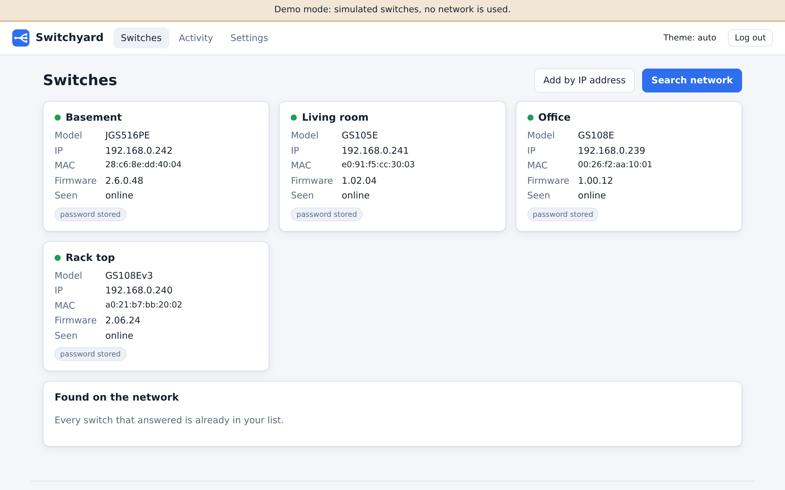
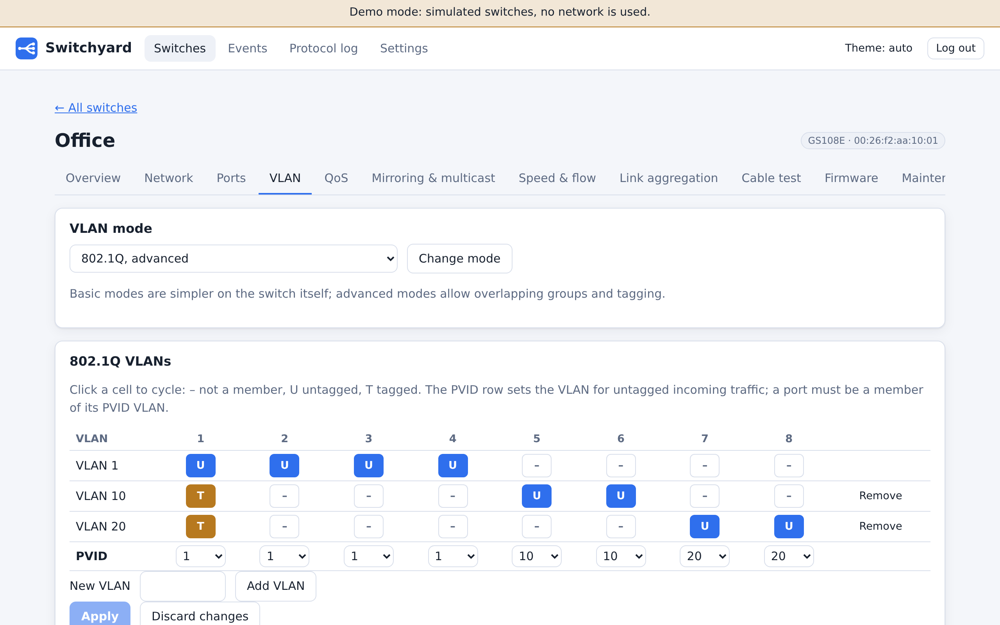
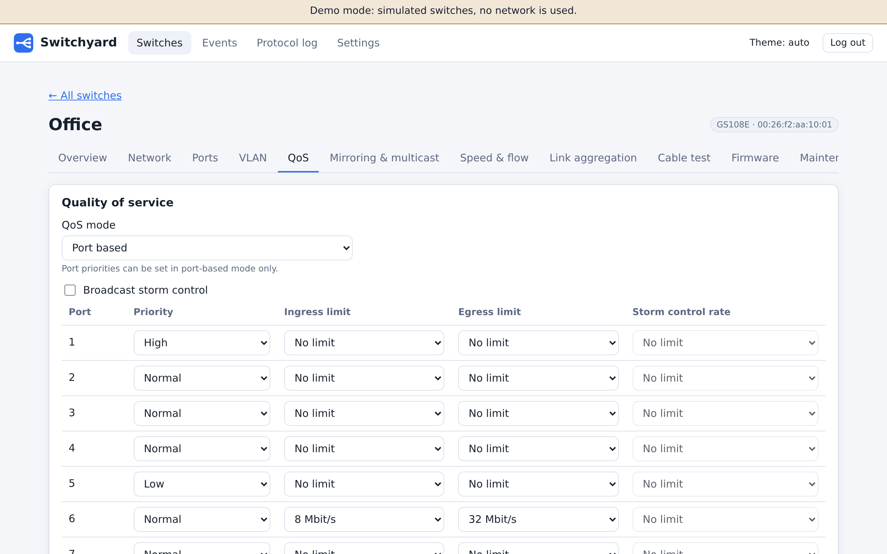
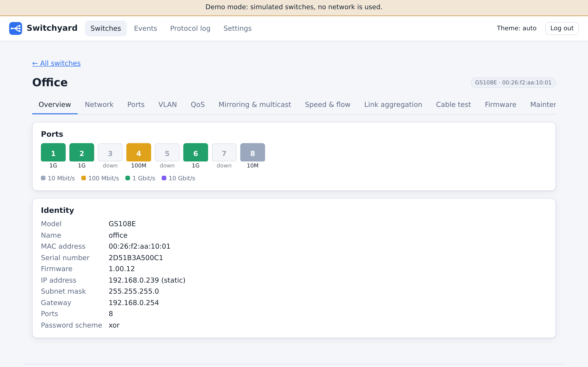
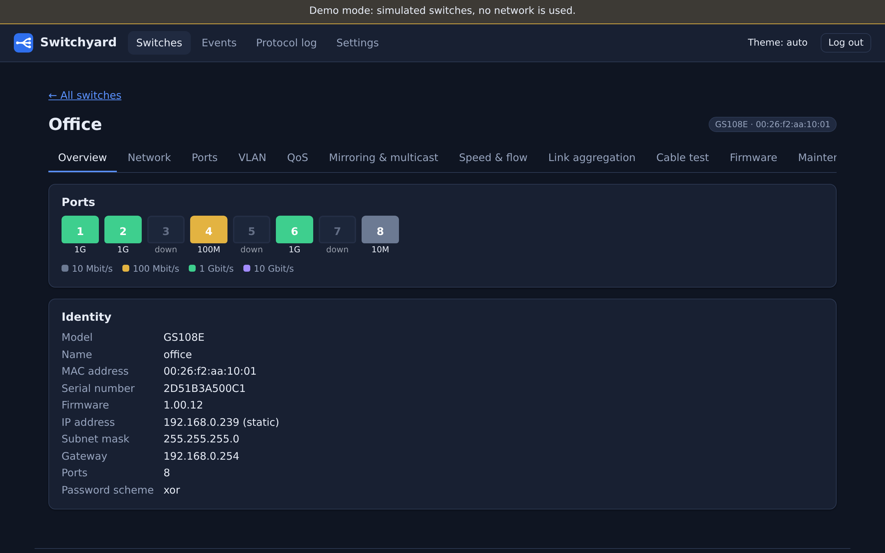

# Switchyard

A web interface for managing NETGEAR ProSAFE Plus ("Smart Managed Plus", "Easy Smart") switches
such as the GS108E. It replaces the Windows-only *ProSAFE Plus Utility* with something you can
run in a container and open from any browser: find your switches, add them to a list, and change
VLANs, QoS, mirroring and more.

> Switchyard is an independent open-source project. It is not affiliated with, endorsed or
> supported by NETGEAR. Product names are used only to say what it works with.



**Status:** version 0.1, developed against a simulator built from public protocol documentation.
It is **not yet verified on real hardware**. Read [docs/HARDWARE.md](docs/HARDWARE.md) before you
point it at a switch you care about, and please report what you find.

## Which switches

Switches that the old utility managed, over its UDP protocol (NSDP). Several models have no web
interface at all, so this is the only way to configure them.

| Switch | Status |
| --- | --- |
| GS108E v1, v2, v3, GS105E (first generation) | expected to work, being verified |
| GS105E v2, GS110EMX, JGS516PE, JGS524PE, XS-series | may work, reports welcome |
| Newer firmware with the Plus Utility turned off | needs a setting change, see [troubleshooting](docs/TROUBLESHOOTING.md) |

## Getting started

1. Run it on a machine in the **same network segment** as the switches. Discovery uses UDP
   broadcast, so the container needs host networking.

   ```yaml
   services:
     switchyard:
       image: ghcr.io/philippmundhenk/switchyard:latest
       network_mode: host
       restart: unless-stopped
       volumes:
         - ./data:/data
       environment:
         SWITCHYARD_AUTH_PASSWORD: "choose-a-password"
   ```

   Or without Docker: `pip install .` then `switchyard serve`.

2. Open `http://<host>:8080` and sign in. Without `SWITCHYARD_AUTH_PASSWORD` a password is
   generated and printed once in the log.
3. Press *Search network* and add your switches. A new switch has the password `password`.
4. Reads need no password. When you change something, Switchyard asks for the switch password.

Want to look around first? `docker run --rm -p 8080:8080 -e SWITCHYARD_DEMO_ENABLED=true -e SWITCHYARD_AUTH_PASSWORD=demo ghcr.io/philippmundhenk/switchyard` starts four simulated switches.

## What it does

| Area | Features |
| --- | --- |
| Discovery | Broadcast search on all interfaces, add by IP for other subnets, several switches in one list |
| Status | Port panel with link speed, live statistics and rates, CRC errors |
| Network | Name, DHCP or static IP |
| VLAN | Port-based and 802.1Q, matrix editor, PVID, safe "apply the whole table" |
| QoS | 802.1p or port based priority, ingress/egress rate limits, broadcast storm control |
| Ports | Speed and flow control per port, link aggregation (static LAG) |
| Other | Port mirroring, IGMP snooping, loop detection, cable test |
| Maintenance | Switch password, reboot, factory reset, JSON backup and restore, **firmware upgrade** (checked image, typed confirmation, progress) |
| Monitoring | Background port polling: traffic history chart, link and online/offline events, live port dots on every card, Prometheus `/metrics`, optional webhook |
| Debugging | Live protocol log with passwords blanked |

Not included: LACP (these switches only do static aggregation), LED and power saving options. Link aggregation, port speed and firmware upgrade are new and, like everything else, **not yet verified on real hardware**; the firmware upgrade is the riskiest function, read [docs/HARDWARE.md](docs/HARDWARE.md) first.

## Screenshots

| | |
| --- | --- |
|  |  |
|  |  |

More in [docs/screenshots.md](docs/screenshots.md).

## Options

Most settings have a sensible default. The common ones:

| Variable | Meaning |
| --- | --- |
| `SWITCHYARD_AUTH_PASSWORD` | Password of the web interface |
| `SWITCHYARD_SERVER_PORT` | Web port, default 8080 |
| `SWITCHYARD_NSDP_INTERFACES` | Search only these interfaces, e.g. `eth0` |
| `SWITCHYARD_NSDP_TARGETS` | Directed broadcast or switch addresses for routed networks |
| `SWITCHYARD_MONITOR_INTERVAL_SECONDS` | How often ports are read for history and events, default 30, 0 = off |
| `SWITCHYARD_METRICS_TOKEN` | Bearer token for `/metrics` |
| `SWITCHYARD_NOTIFY_WEBHOOK_URL` | POST link and online/offline events here |
| `SWITCHYARD_DEMO_ENABLED` | Use simulated switches |

All keys: [docs/CONFIGURATION.md](docs/CONFIGURATION.md).

## Documentation

- [docs/HARDWARE.md](docs/HARDWARE.md) first run on a real switch, recovery, compatibility list
- [docs/DEPLOYMENT.md](docs/DEPLOYMENT.md) Docker, systemd, reverse proxy, routed networks
- [docs/CONFIGURATION.md](docs/CONFIGURATION.md) every setting
- [docs/TROUBLESHOOTING.md](docs/TROUBLESHOOTING.md) nothing found, password refused, locked out
- [docs/security.md](docs/security.md) what is protected and what is not
- [docs/PROTOCOL.md](docs/PROTOCOL.md) the NSDP protocol as Switchyard speaks it
- [docs/DESIGN.md](docs/DESIGN.md) goals, architecture, decisions; [docs/adr](docs/adr/README.md)
- [docs/DEVELOPMENT.md](docs/DEVELOPMENT.md) build, test, contribute; [CONTRIBUTING.md](CONTRIBUTING.md)

MIT licensed. Thanks to the projects that documented the protocol first, see
[docs/DESIGN.md](docs/DESIGN.md#acknowledgements).
