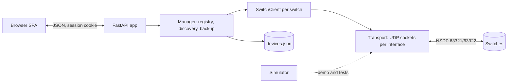

# Design

Status date: 2026-11-18

## Goal

A modern, self-hosted web GUI for the old NETGEAR ProSAFE Plus switches, covering what the
Windows-only Plus Utility 2.7.8 did, for several switches at once.

## Why another tool

A GitHub survey (November 2026) found CLIs and libraries (ProSafeLinux, ngadmin, nsdptool,
go-nsdp), exporters (prosafe_exporter), tools that scrape the web interface of newer models
(py-netgear-plus, ha-netgear-plus, prosafe-vlan-manager) and one desktop app (nsdp-manager).
No self-hosted multi-switch web interface over NSDP. Web scraping does not help the models that
have no web interface.

## Facts used

- The vendor utility was unpacked only to read its feature list, language strings and error
  codes (the installer is an InstallShield wrapper around an MSI with an Adobe AIR application).
  Nothing from it is copied or redistributed.
- Protocol details come from the community projects below and are written up in
  [PROTOCOL.md](PROTOCOL.md).

## Architecture

| Module | Role |
| --- | --- |
| `nsdp/packet.py` | header and TLV codec |
| `nsdp/auth.py` | password encodings |
| `nsdp/tags.py` | tag numbers and value layouts |
| `nsdp/transport.py` | sockets, retries, sequence matching, packet log |
| `nsdp/client.py` | typed reads and authenticated writes for one switch |
| `manager.py` | list of switches, discovery, backup and restore |
| `web/app.py`, `web/auth.py` | HTTP API, login, security headers |
| `web/static/` | single page app, no build step |
| `sim.py` | software switches for tests and demo mode |

## Decisions

See [adr](adr/README.md). In short: Python and FastAPI, a no-build vanilla JS UI, NSDP rather than
scraping, a simulator first, host networking, a password for the UI, no firmware upgrade yet.

## Open questions

- Exact value layouts on each model and firmware (counters, cable test codes, 10G rates).
- Password change on hash-based firmware.
- Which firmware versions disable NSDP and whether they can be re-enabled in every case.

## Acknowledgements

Switchyard would not exist without the people who documented the protocol: the authors of
ProSafeLinux, ngadmin, nsdpc, nsdptool, go-nsdp, nsdp-manager, and the GS105Ev2 research notes.
Their projects were read for facts; no code was copied.
