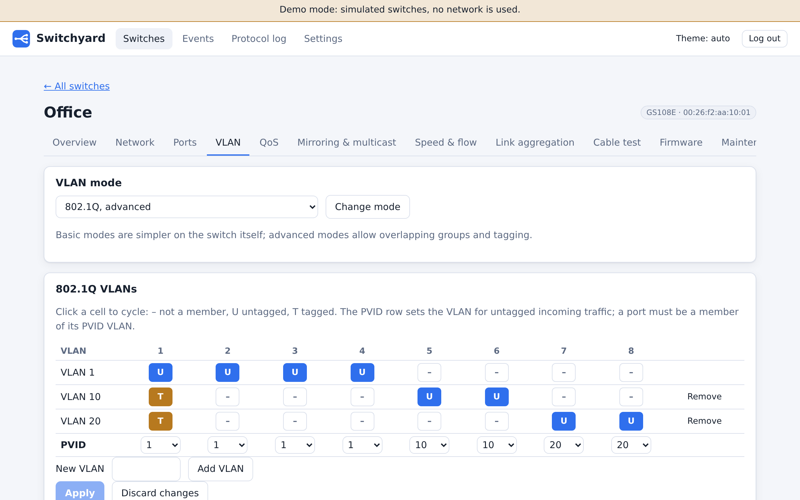
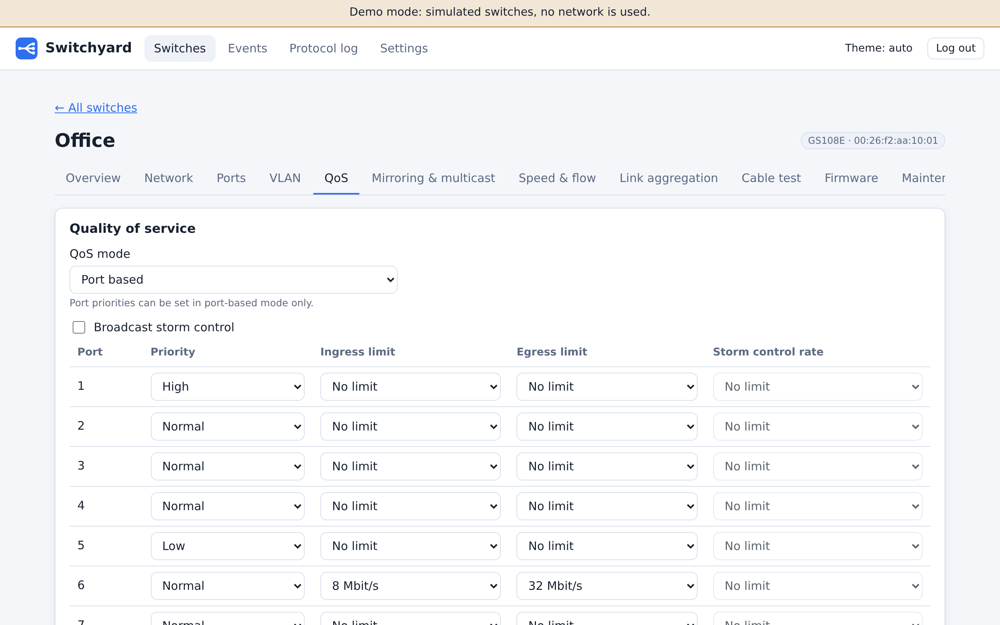
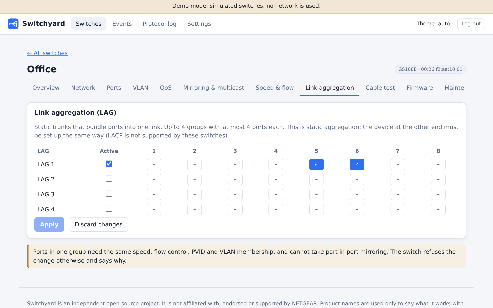
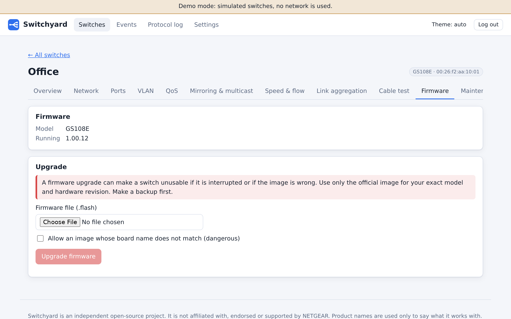
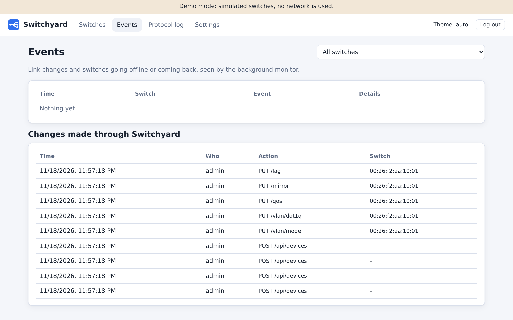
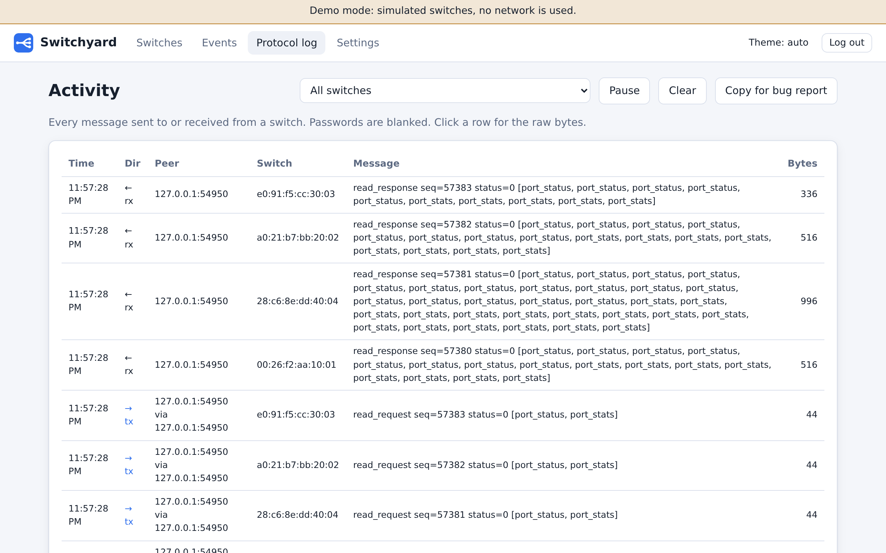

# Screenshots

Made by `python tools/screenshots.py` from the demo server (simulated switches).

| Image | Shows |
| --- | --- |
| `switches.png` | the list of managed switches |
| `overview.png`, `overview-dark.png` | port panel and identity, light and dark |
| `vlan.png` | 802.1Q matrix editor with PVID row |
| `qos.png` | priorities and rate limits |
| `lag.png` | link aggregation groups |
| `firmware.png` | firmware upgrade with its warnings |
| `events.png` | link and online events, audit log of changes |
| `log.png` | live protocol log |
| `phone-switches.png` | phone layout |

